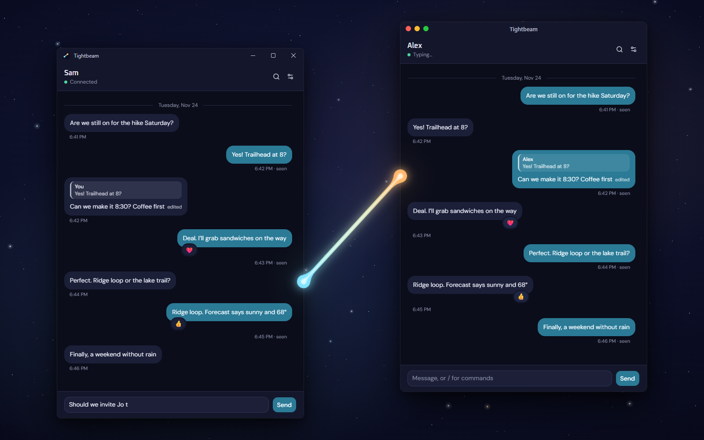

# Tightbeam

A private line between two people on the same network. There's no server and no account. The two apps find each other on the local network, pair once, and talk directly over an encrypted connection. Each side keeps the full history locally.

Windows and macOS. Rust + [Tauri](https://tauri.app) for the app, [iroh](https://iroh.computer) for networking, SQLite for history.



## How it works

- **Identity.** On first launch the app creates a keypair, stored in its SQLite file. The public key is your permanent ID.
- **Discovery.** Each app announces itself on the LAN over mDNS (`_tightbeam._udp.local`), along with its display name.
- **Pairing.** You click a nearby person, and both screens show the same six-digit code, derived from both keys. The other person accepts. From then on, each app only talks to that one key.
- **Connection.** Once paired, the app with the lower ID dials the other every few seconds until connected. The link is QUIC with TLS, authenticated by those keys.
- **Sync.** Messages, and reactions to them, are numbered per author. On connect, each side says "the last one I have from you is #N", and the other sends everything after it. Duplicates are ignored, so resending is always safe. The transcript is ordered by a hybrid logical clock rather than each computer's clock, so a reply never shows above the message it answers.
- **Delivery.** Your message shows "waiting" until the other app confirms it has it, then "delivered". It shows "seen" once their window has had focus with the message in it. Like delivery, "seen" is a number per person ("I've seen up to #N"), re-sent at the start of every connection.

**Replies, reactions, edits:** hover a message to reply to it or react with an emoji, and on your own messages, to edit or delete it (↑ in an empty message box edits your last one). Each person has one reaction per message; picking the same one again takes it back. Each of these is a new numbered entry that points at the message by author and number, so the log is only ever added to, with one exception: a delete also erases the text of the message it deletes, and of its edits, on both computers. While the other person types, the header says "Typing…"; that signal is never stored.

**Commands:** type `/` in the message box for a list. `/clear` erases the conversation on this computer; the other person keeps their copy, and your messages that haven't reached them yet stay so they still get delivered. The erased messages are overwritten in the database file, not just marked free. `/nudge` shakes the other person's window and plays a sound, or shows a notification if Tightbeam is in their tray. `/away lunch` shows the other person "Away · lunch" (the note is optional) until `/back` or your next message. After 10 minutes without keyboard or mouse input anywhere on the computer, you show as away until you're back at it. `/dnd 2h` turns on do not disturb: no notifications or nudge sounds, the other person sees it, and their nudges are paused; `/dnd off` ends it early. `/vanish 1m the code is 4321` sends a message that erases itself from both computers a minute after the other person sees it (both apps need 0.6 or later). `/me waves` shows "Alex waves"; `/shrug`, `/tableflip` and `/unflip` add the face to your message. `/status` shows the connection's address and round-trip time, and both apps' versions. To send a message that starts with a slash, begin it with `//`.

**Pictures:** paste a screenshot, drop pictures on the window, or use the picture button beside the message box; what you type goes with them as a caption. Each picture can be up to 1 GB. The message syncs like any other, carrying the picture's name, size, BLAKE3 hash and a tiny preview, shown blurred until the picture arrives. The picture itself travels on a QUIC stream of its own, so a big one never holds up messages: the receiving app asks for it, checks the whole file against the hash, and keeps it in the data folder under `files/`. A transfer that breaks off picks up where it stopped. Click a picture to see it full size, open it in its default app, save a copy somewhere else, or show it in its folder. The data folder is the app's own: a file moved out of it, or changed in it, is fetched again from the other computer (it's checked against its hash before it's sent), or shows as no longer available if neither has it intact. One this computer can't display, such as HEIC on Windows, shows as a file. Deleting the message or `/clear` removes the file once no message has it, though as an ordinary file delete: unlike message text, it isn't overwritten on disk. Both apps need 0.7 or later.

**Search:** the magnifier in the header, Ctrl+F (Cmd+F on macOS), or `/search words`. Each word matches words that start with it, ignoring case and accents, and a message must match them all. Matches are listed newest first; picking one scrolls to it, loading older history if needed. The index (SQLite FTS5) holds each message's current text, so edits are found by their new text and deleted or cleared messages aren't found at all.

**In the background:** closing the window hides it. Tightbeam keeps running in the tray (menu bar on macOS) so messages still arrive, with notifications and an unread count. Quit from the gear menu or the tray icon, or with Cmd+Q on macOS. Opening Tightbeam again brings back the running window. Settings (the gear in the header) toggle notifications and start-at-login, which starts it in the tray.

**Updates:** Tightbeam checks GitHub Releases for a new version 30 seconds after it starts, then every 6 hours. It downloads the update in the background and checks the update's signature against the public key in `tauri.conf.json`. A bar then offers to restart into it. Settings has "Check for updates", and "Automatic updates" to turn the checks off. Development and test builds never check.

**Privacy:** the app never asks your router to open a port (UPnP is off), never contacts relay or DNS servers, and only advertises private LAN addresses. Its one connection beyond the LAN is the update check, which tells GitHub your IP address and that you use Tightbeam. Messages never leave the LAN.

## Layout

```text
ui/src/api.ts             typed wrappers for the Rust commands, plus the shared types
ui/src/store.ts           app state (TanStack Store), fed by events from Rust; history paging
ui/src/commands.ts        slash commands
ui/src/components/        the screens: Setup, Pair, Chat, Search, Files, PairDialog, Notice
ui/src/components/ui/     shadcn/ui components (generated; update with the shadcn CLI)
src-tauri/src/chat.rs     the engine: discovery, pairing, protocol, sync
src-tauri/src/db.rs       SQLite storage and history paging
src-tauri/src/lib.rs      Tauri commands and events
src-tauri/src/desktop.rs  tray, unread count, notifications
src-tauri/src/updates.rs  automatic updates
src-tauri/tests/          two real engines chatting; paging through 50,000 messages
src-tauri/examples/seed.rs  fills two test profiles with a long synthetic history
```

The UI is React + TypeScript + Tailwind v4 with [shadcn/ui](https://ui.shadcn.com) on Base UI, built with Vite. The transcript uses shadcn's Message Scroller and loads history 200 messages at a time as you scroll up. Theme colors are shadcn's tokens in `ui/src/styles.css` (`bg-background`, `text-muted-foreground`, `bg-primary`, …), with dark-mode values that follow the system. Add components with `bunx shadcn@latest add <name>`.

To try a long history: open both test windows once (`.\scripts\two-windows.ps1 -Fresh`), pair them, close them, then `cd src-tauri; cargo run --example seed -- $env:TEMP\tightbeam-alice $env:TEMP\tightbeam-bob 50000`.

## Develop

Needs Rust (via rustup) and bun. The Tauri CLI comes with `bun install`.

```powershell
bun install            # once
bun tauri dev          # run the app; the UI hot-reloads as you edit
bun tauri build        # make an installer in src-tauri/target/release/bundle/
cd src-tauri; cargo test   # run the two-peer test (about 5 seconds)
```

`bun run dev` alone starts only Vite. The UI needs the Tauri bridge, so it won't work in a regular browser.

For the TypeScript, from the project root:

```powershell
bun run check          # type-check, lint (oxlint), format check (oxfmt), Markdown lint
bun run fmt            # format
```

For the Rust, in `src-tauri`: `cargo fmt` and `cargo clippy --all-targets`. CI runs all of these checks and the tests on Windows and macOS, for every push to main and every pull request.

**Two copies on one PC.** From the project root, run `.\scripts\two-windows.ps1` (add `-Fresh` to start over). It gives each copy its own data folder and uses loopback, because Windows refuses to send from a machine's LAN address to that same address. Close any running Tightbeam first.

**Start over.** Delete the app's data folder: `%APPDATA%\chat.tightbeam.desktop` on Windows, `~/Library/Application Support/chat.tightbeam.desktop` on macOS.

## Releases

```powershell
.\scripts\release.ps1 0.2.0
```

First, add what changed under `## Unreleased` in `CHANGELOG.md`, push, and let CI pass. The script checks for all three.

It then moves the Unreleased entries under the new version and sets the version in `src-tauri/Cargo.toml`, the only place it's stored (`tauri.conf.json` falls back to it). Finally it commits, tags `v0.2.0` and pushes.

The tag starts the Release workflow. It runs CI on the tagged commit, then builds the Windows installer and the macOS app (Apple Silicon, `.dmg`) into a draft release on GitHub. The draft's text is that version's changelog section plus the install steps in `.github/release-footer.md`. Check the draft, then publish it.

Dependabot opens a pull request each month for dependency updates. The GitHub Actions in the workflows are pinned to exact commits, and Dependabot updates those too.

CI signs the update files with the updater's private key. It reads the key from the repository secrets `TAURI_SIGNING_PRIVATE_KEY` and `TAURI_SIGNING_PRIVATE_KEY_PASSWORD`; `src-tauri/tauri.release.conf.json` turns signing on. Local and SSH builds skip the update files, so they don't need the key. Keep a backup of the key. Without it, installed copies can't update, and every install has to be replaced by hand.

Installed copies update from a release once it's published. Drafts and pre-releases are never offered.

The builds aren't signed with a paid certificate, so the first install shows a warning:

- **Windows:** SmartScreen. Choose "More info", then "Run anyway".
- **macOS:** open the app once, then go to System Settings → Privacy & Security and choose "Open Anyway".

## Building for macOS by hand

Tauri can't build Mac apps from Windows. To get a Mac build of an unreleased branch, build on a Mac over SSH: `scripts/setup-mac.ps1` prepares the Mac once, and `scripts/build-mac.ps1` builds the `.app` from GitHub. Both expect an SSH alias named `mac-mini`.

`src-tauri/Info.plist` declares the mDNS service and a Local Network usage reason. Without them, macOS silently blocks discovery.
